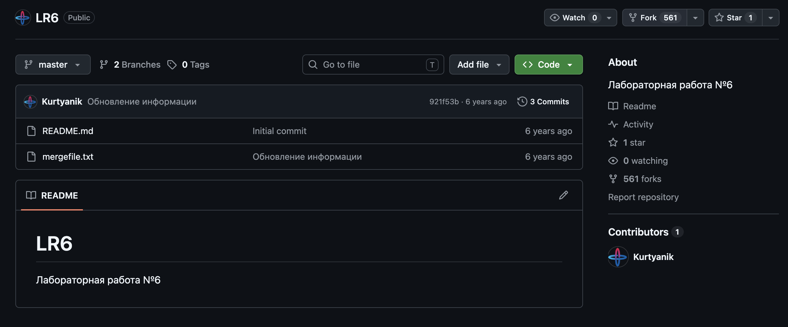
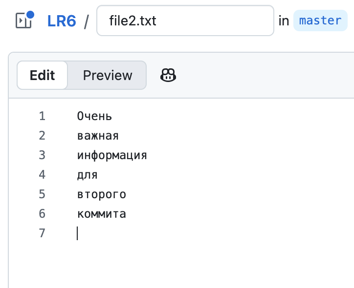
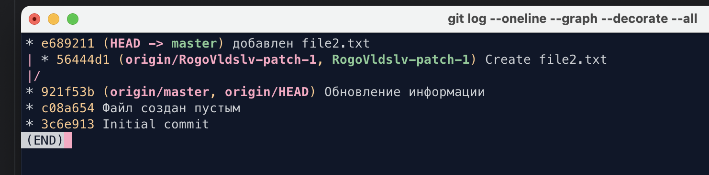
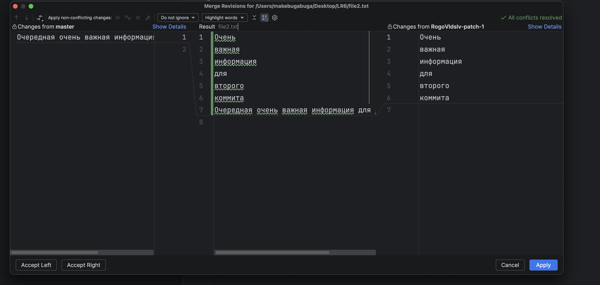
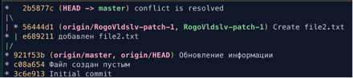
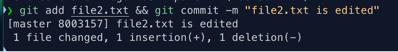
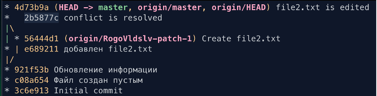
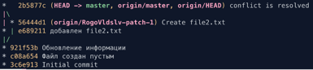

# LR6
Лабораторная работа №6

Так как аккаунт на GitHub уже был создан, первым шагом был перенесён к себе на аккаунт с помощью кнопки fork (рис. 1).\
\
Рисунок 1 - Репозиторий для форка
---
Затем, в визуальном интерфейсе сайта был создан файл file2.txt и сохранён в ветку `RogoVldslv-patch-1`. С содержанием файла можно ознакомиться на рисунке 2.\
\
Рисунок 2 - Содержание файла file2.txt
---
Следующим шагом проект был скачен на компьютер с помощью команды `git clone https://github.com/RogoVldslv/LR6`. Все следующие действия с git проводились на локальной машине.\
С помощью команды `git log --oneline --graph --all` можно наглядно посмотреть на историю всех коммитов: хешей и названий в виде графа (рис. 3). \
\
Рисунок 3 - Вывод git log --oneline --graph --all
---
Команда `git show RogoVldslv-patch-1` позволила наглядно посмотреть изменения последнего комита ветки `RogoVldslv-patch-1`.\
Далее, в ветке master был создан файл с таким же названием, как и в предыдущем коммите – file2.txt, но с другим содержанием. После этого была произведена попытка слияния ветки `RogoVldslv-patch-1` в ветку `master`. Из вывода видно, что произошёл конфликт из-за разного содержания одного и того-же файла.\
С помощью IDE Pyсharm конфликт был решен в визуальном интерфейсе. Оба содержания файла были включены в следующий коммит для завершения слияния веток (рис. 4). С конечным видом коммитов можно ознакомиться на рисунке 5.
\
Рисунок 4 – Визуальное решение конфликта в IDE
---
\
Рисунок 5 - Вывод команды git log --oneline --graph --all после слияния
---
Следующим шагом стало удаление побочной ветки после слияния с помощью команды `git branch -d RogoVldslv-patch-1`. Флаг `-d` позволяет безопасно удалить ветку, т. е. если ветка слита с main. Сообщение `Deleted branch RogoVldslv-patch-1 (was 56444d1)` дало понимание того, что ветка успешно удалена.\
Затем, в файле file2.txt было удалено последнее слово, с помощью команды `git add` файл был добавлен в список отслеживаемых файлов, а с помощью команды `git commit` был сохранен. Флаг `-m` позволяет задать комментарии к сохранению. С результатом можно ознакомиться на рисунке 6. \
\
Рисунок 6 – Сохранение изменения файла file2.txt
---
Затем был сделан `git reset --hard 2b5877c` для полного удаления коммитов до коммита с хеш-номером 2b5877c, т. е. до предыдущего. С результатами до и после удаления можно ознакомиться на рисунке 6 и 7 соответсвенно.\
\
Рисунок 7 – Git log до отката коммита
---
\
Рисунок 8 – Git log после отката коммита
---
С помощью команды `git log --date=short --pretty=format:"%h | %ad | %an | %s"` была получена история коммитов в формате таблицы.\
```
c2dde58 | 2026-11-19 | parlament700 | second part of report\
ea197f0 | 2026-11-19 | parlament700 | first part of report\
2b5877c | 2026-11-19 | parlament700 | conflict is resolved\
e689211 | 2026-11-19 | parlament700 | добавлен file2.txt\
56444d1 | 2026-11-19 | RogoVldslv | Create file2.txt\
921f53b | 2020-11-21 | Kurtyanik | Обновление информации\
c08a654 | 2020-11-21 | Kurtyanik | Файл создан пустым\
3c6e913 | 2020-11-21 | Kurtyanik | Initial commit\
```


